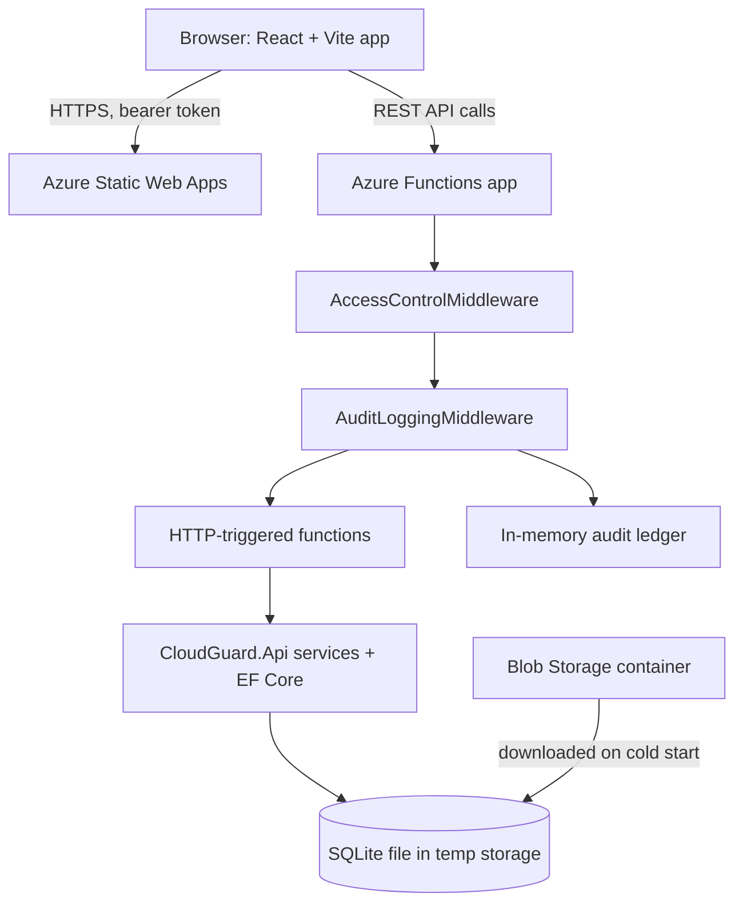

# CloudGuard

A fleet-monitoring and patch-compliance dashboard for a simulated data-centre estate. It tracks 433 seeded servers across four buildings, shows which ones are missing security patches, lets an operator remediate them, and keeps an audit ledger of who did what.

The frontend is React and TypeScript. The backend is .NET 10, deployed as an Azure Functions app. The whole thing is built and deployed through GitHub Actions.

> **This project is also an experiment.** I wanted to see how much of a working, deployed application I could build with AI tools while I steered. See [How this was built](#how-this-was-built) for the honest account, including what went wrong.

## Demo

<!-- TODO: replace this block with the 3-4 minute demo video (YouTube/Loom link or an uploaded GIF/MP4). -->

**Demo video coming soon.**

The live site sits behind a shared password so that bots can't run up the Azure bill. If you're reviewing this project and want access, ask me and I'll send you the link and password directly.

<!-- TODO: add 2-3 screenshots (fleet view, server deep-dive, analytics) under docs/images/ and link them here. -->

## What it does

- **Fleet view.** A searchable, filterable table of all servers with compliance status (Compliant, Vulnerable, Critical), plus summary metric cards.
- **Scoped navigation.** A sidebar tree of buildings and server rooms narrows the fleet to one room.
- **Server deep-dive.** Per-server telemetry: CPU, RAM, IP and MAC address, uptime, hardware age, average load over 24 hours, 1 week and 1 month, and recent shell commands.
- **Patch remediation.** Remediate a server's missing patches from the UI.
- **Exports.** Download a CSV audit of the current scope, or a plain-text report for a single server.
- **Cluster analytics.** Recharts dashboards: a compliance donut chart and per-building hardware allocation bars.
- **Audit ledger.** A view of who did what: user, role, action, path, outcome and UTC timestamp.
- **Light and dark themes.**
- **Password lock** on the deployed site (see [Security model](#security-model)).

## Architecture



The repository holds three .NET projects and one client:

```
CloudGuard/
├── src/
│   ├── CloudGuard.Api/        Domain, EF Core + SQLite, services, security, and a
│   │                          standalone ASP.NET Core Web API for local development
│   ├── CloudGuard.Functions/  Azure Functions host (isolated worker) that reuses
│   │                          CloudGuard.Api and adds middleware + HTTP triggers
│   └── CloudGuard.Client/     React + TypeScript + Vite single-page app
├── tests/
│   └── CloudGuard.Api.Tests/  xUnit tests for the API, services and security code
├── scripts/                   set-access-secrets.sh (sets the production password)
└── .github/workflows/         ci.yml (build + test) and deploy.yml (ship to Azure)
```

The business logic lives once, in `CloudGuard.Api`. The Functions app is a thin hosting layer on top, so the same services and tests cover both the local API and the deployed one.

## Tech stack

| Layer | Technology |
| --- | --- |
| Frontend | React 19, TypeScript, Vite, Recharts. Styling is plain CSS variables and inline styles. |
| Frontend tests | Vitest, Testing Library, Playwright (end-to-end) |
| Backend | C# on .NET 10, ASP.NET Core, EF Core 10 with SQLite, Polly 8 (retry/resilience), OpenAPI |
| Hosting | Azure Functions v4 (isolated worker, Flex Consumption), Azure Static Web Apps (Free tier), Azure Blob Storage |
| Backend tests | xUnit, NSubstitute, `WebApplicationFactory` integration tests |
| CI/CD | GitHub Actions, Codecov for coverage |

## Design decisions and trade-offs

- **Isolated worker model.** The project targets .NET 10, which Azure Functions supports only through the isolated worker. It also lets the Functions app use ordinary ASP.NET Core middleware and share code with the standalone API.
- **Flex Consumption plan.** The site is used rarely and in short bursts, so paying per execution suits it. Flex Consumption also lets me cap scale-out; I set the maximum to 5 instances so a burst of traffic can't turn into a surprise bill.
- **SQLite instead of a managed database.** For a demo with 433 rows, a database server would cost more than the rest of the app and add nothing. The seeded `cloudguard.db` file is stored in a Blob container and downloaded into the instance's temp folder on cold start.
- **One shared codebase for local and cloud.** Locally you run the plain ASP.NET Core API (open, no login). In the cloud the same services run behind Functions with the password lock in front.
- **Resilience on the data layer.** `ResilientAssetServiceDecorator` wraps the asset service with Polly retries.
- **Less polling.** The fleet view refreshes every 2 hours and pauses entirely while the browser tab is hidden. The audit ledger refreshes every 60 seconds, but only while it is open.
- **Build-time configuration, not auto-detection.** The client reads `VITE_API_BASE_URL` (default `http://localhost:5003`) and `VITE_REQUIRE_LOGIN` when it is built. The deploy workflow sets them for production; a local `npm run dev` doesn't need them.

## Security model

CloudGuard is a portfolio piece, so the security is deliberately simple. It is meant to keep casual bots and scrapers out, not to be a full identity system.

- **Shared-password lock.** `POST /api/login` checks a password and returns a 12-hour token. The password comparison is hashed and fixed-time. The token is an HMAC-SHA256 signed token built without extra packages. If the password or signing key isn't configured, the API fails closed and answers 503.
- **Everything else needs the token.** `AccessControlMiddleware` runs before every function except login, and before the audit middleware, so rejected requests never reach the ledger.
- **Secrets stay out of the repo.** The password and signing key are app settings. `scripts/set-access-secrets.sh` sets them. `local.settings.json` is untracked; copy `local.settings.sample.json` to create yours.
- **HTTPS-only** is enabled on the Function App.
- **Operator identity.** The client sends `X-CloudGuard-User` and `X-CloudGuard-Role` headers when remediating. These are *claims for audit labelling*, not verified identities.
- **Audit ledger.** Each request is recorded with user, role, action, path, outcome and timestamp. The deployed ledger is held in memory and capped at 500 entries.

## Cost and operations notes

The project is designed to stay inside free tiers and Azure's free monthly grants, but I don't promise it costs nothing. These are the guards in place:

- Static Web Apps on the Free tier.
- Function App scale-out capped at 5 instances.
- Fleet polling every 2 hours, paused in hidden tabs.
- A password gate so crawlers can't hammer the API.
- A low-threshold Azure budget alert. It sends email and does not stop anything.

## Local development

### Prerequisites

- .NET 10 SDK
- Node.js (current LTS) and npm
- [Azure Functions Core Tools](https://learn.microsoft.com/azure/azure-functions/functions-run-local), only if you want to run the Functions host

### Run the API and client (the simplest setup)

```bash
# Terminal 1: API on http://localhost:5003 (open, no login)
cd src/CloudGuard.Api
dotnet run

# Terminal 2: client
cd src/CloudGuard.Client
npm ci
npm run dev
```

On startup the API seeds 433 servers into SQLite. A background worker nudges a random server's status every minute, so the dashboard changes while it's open. **A Debug build deletes `cloudguard.db`**, so the data is reseeded on each run.

### Run the Functions host (optional)

```bash
cd src/CloudGuard.Functions
cp local.settings.sample.json local.settings.json   # then edit the values
func start
```

The Functions host needs a seeded `cloudguard.db` next to the build output. Without a storage connection string it falls back to a local file. To test the lock locally, build the client with `VITE_REQUIRE_LOGIN=true`.

### Tests

```bash
dotnet test CloudGuard.slnx                      # backend (xUnit)
cd src/CloudGuard.Client && npm run test         # client (Vitest)
```

There are also Playwright end-to-end tests in `src/CloudGuard.Client/e2e`.

## CI/CD

- **`ci.yml`** runs on pull requests and pushes to `main`: build, run the .NET and client tests, upload coverage to Codecov.
- **`deploy.yml`** runs on `main` in three stages: test, then deploy the Functions app (built, zipped and pushed with the Azure CLI), then build and deploy the client to Static Web Apps.

## How this was built

I've hand-coded my other portfolio projects. This one was an experiment: how far can I get building a real, deployed app mostly with AI, while I act as the engineer who guides it?

**Phase 1: Google's free AI mode.** It wrote most of the first version of the app, including the initial tests. I copied its output in by hand. Sometimes it wrote prompts for me to paste into the Zed editor's agent panel, and sometimes I used Gemini through GitHub Copilot.

**What I had to steer.** The AI didn't suggest writing tests, so I told it to do that early. I also kept asking for advice on git branching because I wanted a clean commit history. Partway through I learned about squash-and-merge, which is why the first several commits in this repo aren't squashed and the later ones are.

**Where it fell apart: Azure.** The free AI was no help with deployment. I ended up with a lot of failed CI runs and a messy branch, so I deleted that branch and started again. To get unstuck, I studied for a day and passed the Microsoft **AZ-900** (Azure Fundamentals) exam the next day. That let me read my own Azure account, see the mess in it, and clean it up.

**Phase 2: Claude Sonnet 5.5.** I switched to Claude Sonnet 5.5 (through GitHub Copilot, in Zed's agent panel). From there it did most of the work: the Azure deployment, porting the API to Azure Functions, the CI/CD pipeline, the polling reduction and the password lock. I made the decisions on scope, cost and security, reviewed what it did, and merged every pull request myself.

The point isn't that AI did everything. It's that I can take a vibe-coded project from nothing to a finished, deployed app, and keep it tidy, tested and understood along the way.

## Known limitations

- **The audit ledger is in memory, per instance.** It resets when an instance restarts, and different instances can hold different partial histories. A durable store (such as Table Storage) is the natural next step.
- **Remediations aren't persisted in the cloud.** The Functions app downloads the database once and edits only its local copy; it never writes back to Blob Storage.
- **The lock is a shared password, not user accounts.** The operator headers are unverified claims.
- **The CORS allow-list on the Function App needs tidying.** It contains stale entries and a wildcard.
- **Cloud data is static between remediations.** The simulated status drift runs only in the local API.
- **The client's dependency audit currently reports vulnerabilities** that I haven't triaged yet.
